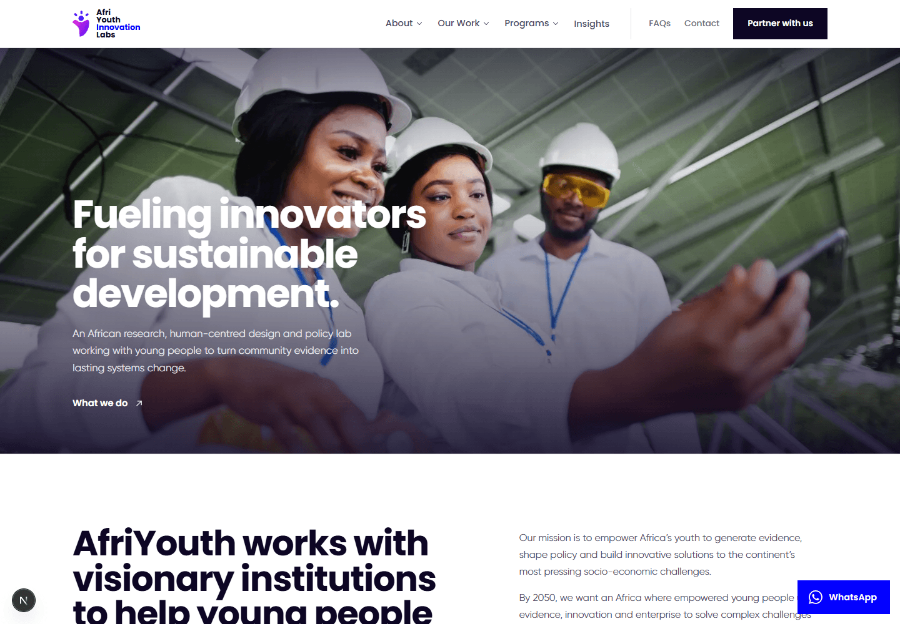
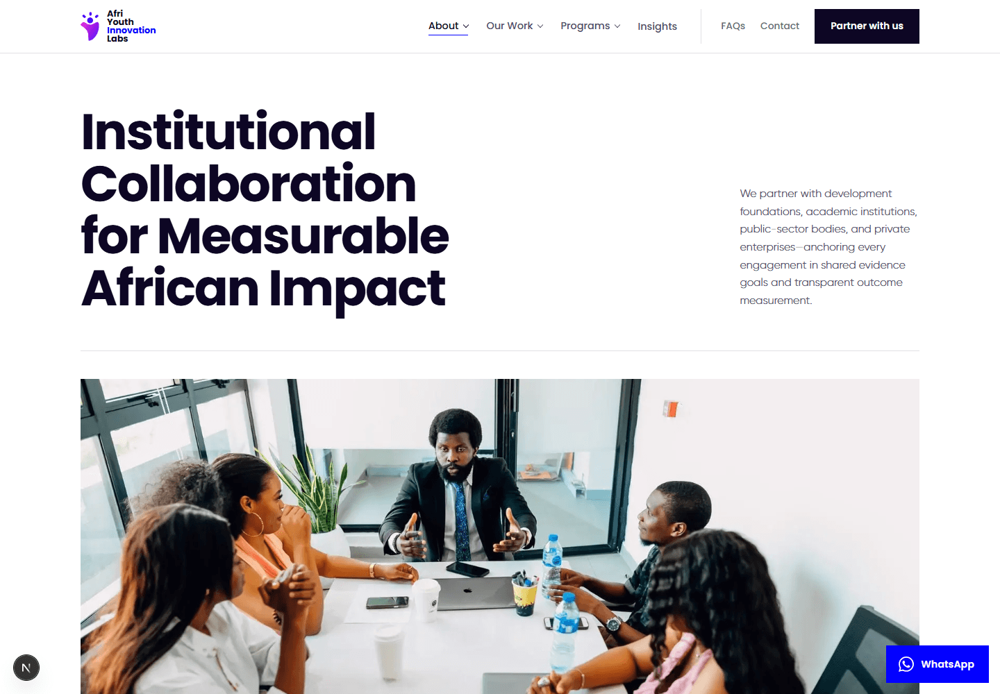
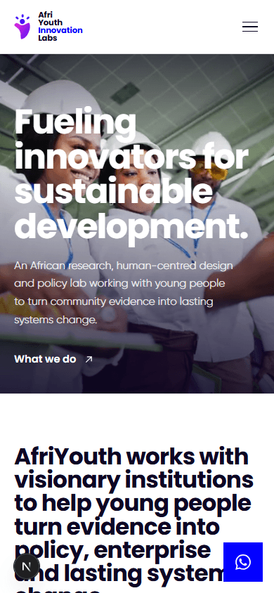

# AfriYouth Innovation Labs

A design-led marketing site for **AfriYouth Innovation Labs**, an African research,
human-centred design and policy lab that helps young people turn community evidence into
policy, enterprise and lasting systems change.

The site is built with Next.js and plain CSS Modules. It has no component library in the
dependency graph and no icon package — every mark, badge and line icon is drawn in the
project itself.

```bash
npm install
npm run dev      # http://localhost:3000
npm run build    # production build
npm run lint     # ESLint
```

## Screenshots

**Home — documentary hero and mission statement**



**Partnerships — editorial page opening**



**Home on mobile**



Screenshots are captured from the running site at `1440×1000` (desktop) and `390×844` (mobile).

---

## Design direction: The Evidence Ledger

The site is composed like a working lab notebook crossed with an editorial journal, not a
generic NGO template. It is deliberately quiet: white paper, ink typography, one electric
blue, and documentary photography treated as evidence plates rather than decoration.

The single recurring visual idea is the **Evidence-to-Impact continuum** — a measured line
running through ten stages from community evidence to continental scale. That metaphor
drives the home page, the approach page and the icon system instead of an accent colour
repeated on every card.

Full rationale, colour roles and component rules live in [`DESIGN.md`](./DESIGN.md).

### Colour

| Token | Value | Role |
| --- | --- | --- |
| `--paper` / `--surface-page` | `#FFFFFF` | Default surface |
| `--surface-subtle` | `#F3F3F6` | Secondary bands, form wells, marquee backdrop |
| `--surface-ink` | `#0D0624` | Dark panels, footer, one bold moment per page |
| `--ink-primary` | `#0D0624` | Body and heading text |
| `--ink-secondary` | `#4D4866` | Leads and supporting copy |
| `--ink-muted` | `#6D6880` | Metadata and labels |
| `--brand-blue` | `#0301FF` | The one functional accent: links, focus, active states |
| `--color-signal` | `#C723DF` | Signal only: status dots, section markers, oversized quote marks |
| `--brand-lavender` | `#C9C8FF` | Accent on dark surfaces |

Rules: no decorative gradients and no tinted near-black. The only sanctioned gradient is
inside the official logo mark, and the only shadows belong to the deliberately floating
marquee cards. Magenta is a signal, not a paint pot.

### Typography

Brand guidelines set the type pairing:

- **Poppins** (400–700) for display, headings, navigation, labels, buttons and metadata.
  Loaded through `next/font` as `--font-poppins`.
- **Gilroy** (self-hosted) for body copy and long-form reading.

Display sizes sit at `1.02–1.06` line-height with tight letter-spacing; body copy runs at
`1rem / 1.7` with a `62ch` measure. Numbers use tabular figures so the animated home stats
do not shift width while counting.

### Layout

- 12-column grid, `1320px` maximum, fluid gutters, left-aligned by default.
- Section rhythm: `clamp(72px, 8vw, 128px)`.
- Recurring editorial splits: `7/5` opening, `5/7` feature, `8/4` index plus note.
- **Square corners everywhere.** Controls, cards, badges and images are square; only
  status dots are round.
- Hairlines (`1px`) replace card borders, shadows and coloured panels wherever possible.

### Motion

Motion is used one idea at a time, never as a section-by-section fade-up:

- A diagonal arrow link underline draws in on hover; images settle at `1.02×`.
- The home page uses gentle **proximity scroll snapping** (`y proximity`, never
  `mandatory`) so short sections settle beneath the sticky header while long sections keep
  scrolling freely.
- **Partner organizations** drift in a single floating-card marquee.
- **Testimonials** run as two floating-card rows in opposite directions, with oversized
  deep-pink quote marks. Duplicated loops are `aria-hidden`.
- Home statistics **count up once** when scrolled into view (IntersectionObserver + rAF).
- All animation collapses under `prefers-reduced-motion`.

---

## Page map

| Route | Role |
| --- | --- |
| `/` | Full editorial narrative: hero, mission, five labs, continuum, stats, research shelf, programmes, partnership pillars, partner organizations, participant testimonials, social follow |
| `/about` | Organisation story, values, Africa footprint map, five strategic divisions with icons, governance, partner organizations, testimonials |
| `/approach` | Capabilities and the 10-stage Evidence-to-Impact continuum |
| `/our-work` | Five labs and the work chapters inside them |
| `/programs` | Programme directory with anchored detail sections |
| `/partnerships` | Partnership models by institution type, advisory, partner organizations, partner testimonials |
| `/insights` | Research and publication shelf |
| `/faq` | Programme, participation and partnership questions |
| `/contact` | Contact details with channel icons and the inquiry form |
| `not-found` | Custom 404 in the same editorial system |

Images live in `public/images` (documentary photography with alt text). Global styles and
design tokens live in `src/styles`, page and component styles are colocated CSS Modules.

### Signature components

- **`ContinuumMark`** — the ten-tick measured line used as the site's one motif.
- **`LineIcon`** — a shared square-stroke icon set (`compass`, `pulse`, `book`, `pen`,
  `cube`, `building`, `coin`, `flag`, `bars`, `expand`, `lightbulb`, `eye`, `people`,
  `pin`, `mail`, `phone`) used for accelerator stages, About divisions, publication
  categories and contact channels.
- **`PartnerPillarIcon`** — four bespoke icons for the home partnership groups.
- **`PartnerOrganizations`** / **`Testimonials`** — floating-card marquees with hover pause,
  seamless duplicated tracks, reduced-motion fallback to horizontal scrolling, and
  page/subtle/ink background variants.
- **`CountUpStat`** — scroll-triggered stat animation that preserves leading zeros (`05`).
- **`PublicationCover`** — typographic monograph covers instead of stock imagery.

---

## How the website communicates with users

Communication is intentionally **direct and low-friction** — the site prepares a message
and hands it to the visitor's own email or WhatsApp app. There is no backend, database or
transactional email service in this project.

### 1. Navigation that explains itself

- A sticky white navbar with the four-line logo lockup and three **mega menus** — About,
  Our Work and Programs. Each menu pairs every destination with a one-line description, so
  visitors choose by outcome rather than guessing from labels.
- A persistent **"Partner with us"** CTA, utility links to FAQs and Contact, and a
  full-screen mobile drawer.
- Menus close on Escape, blur, mouse leave or navigation, and expose `aria-expanded` /
  `aria-controls`.

### 2. Contact page — structured inquiry

`ContactInquiryForm` is a client component that collects name, organisation, email, phone,
an **inquiry pathway** (partnership, commissioned research, employability programme, policy
challenge, resource mobilisation) and a message. On submit it:

1. Builds a fully formatted `mailto:` addressed to `info@afriyouthlabs.org`, including every
   field and the chosen pathway in the subject.
2. Opens the visitor's email app.
3. Shows a live-region confirmation with a fallback link and an "Edit inquiry" action if
   their mail app did not open.

The contact page also lists the Kigali office, email desks, telephone/office hours and next
steps, each labelled with a line icon. It never claims a message was sent when it was only
prepared.

### 3. WhatsApp chat

`WhatsAppChat` is a floating, accessible dialog available on every page:

- Three quick topics — commission research, explore a partnership, ask about programmes —
  open WhatsApp with a **pre-written message**.
- A general start-chat button and an email fallback sit in the same panel.
- Focus moves into the panel on open, Escape closes it and returns focus to the trigger;
  `role="dialog"`, labels and expanded state are wired correctly.

### 4. Newsletter and social follow

- The footer newsletter form validates the address and opens a pre-addressed subscription
  email, then shows a status message with a direct fallback address.
- "Follow the work as it happens" on the home page and the footer social row link to the
  organisation's channels (`src/data/social.ts`).

### 5. Editorial calls to action

Every section ends in an outcome-named action — "Read our approach", "Commission a study",
"View all research", "Explore partnership models" — rather than generic "Learn more". Arrow
links carry the affordance; the underline is the hover state.

### 6. Accessibility as communication

- Skip-to-content link, semantic landmarks and heading order.
- Visible blue focus rings, switching to lavender on ink surfaces.
- Descriptive alt text on all documentary images; decorative icons and duplicate marquee
  items are hidden from assistive technology.
- Forms use real labels, `role="status"` / `aria-live` confirmations and keyboard-safe dialogs.
- `prefers-reduced-motion` disables snapping, marquees and count-up animation.

> **Content note:** partner organizations and testimonials use illustrative placeholder
> entries in `src/data/partners.ts` and `src/data/testimonials.ts`. Replace names, quotes,
> roles and logos with approved content before launch.

---

## Project structure

```
src/
  app/                 routes, layout, global CSS, page-level modules
  components/          navbar, footer, shared editorial and communication components
    home/              home-only rails, shelf, covers, count-up stat
    forms/             contact inquiry form
    about/             Africa footprint map
    programs/          programme directory
  data/                typed content: labs, programmes, partners, testimonials, social
  styles/              design tokens, fonts, shared editorial classes
public/images/         documentary photography and credits
docs/screenshots/      README screenshots of the live pages
DESIGN.md              full design system and rationale
```

## Stack

- Next.js 16.4 (App Router, Turbopack) and React 19
- TypeScript
- CSS Modules plus a global token layer — no UI framework, no icon library, no animation library
- `next/font` for Poppins; Gilroy self-hosted
